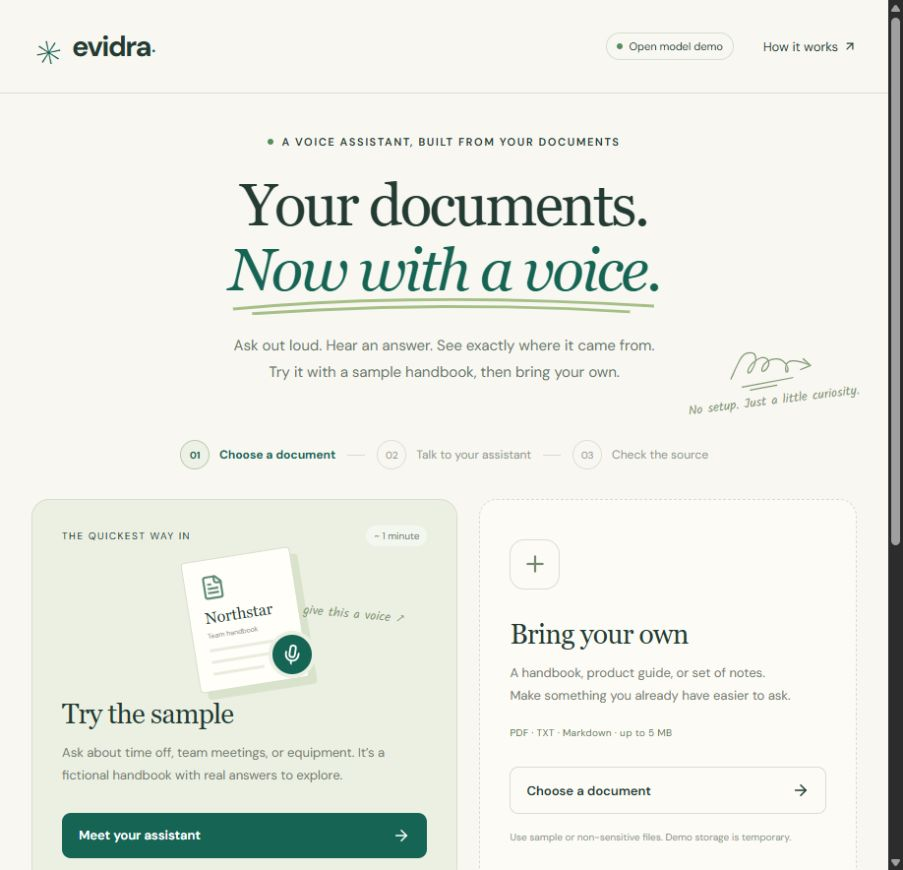

# Evidra

**Turn a document into a voice assistant.**

Evidra lets someone ask questions about a handbook, product guide, or set of notes instead of searching through pages. They can speak in English or Hindi, hear a short reply, and check the passage behind it.

[Try the live demo](https://huggingface.co/spaces/rshalvi/evidra)



## See it in one minute

1. Choose **Try the sample**. A fictional company handbook is ready immediately.
2. Click **Start talking**, allow the microphone, and ask: “How many days of paid leave do I get?”
3. Pause. The assistant replies aloud and shows the handbook passage: employees receive 24 days each year.

Choose **हिन्दी · Hindi** to ask “मुझे साल में कितने दिन की छुट्टी मिलती है?” You can also type a question or upload a searchable PDF, text file, or Markdown document.

## Why build this?

An answer without a source is hard to trust. A document without a way to ask questions is hard to use. Evidra brings the two together in a small, inspectable voice experience.

This is an independent portfolio project demonstrating voice-agent engineering: microphone capture, speech recognition, document retrieval, constrained model answers, speech playback, interruption, and visitor isolation. It is not affiliated with Synthio Labs.

## What a visitor can do

- Talk to a document in English or Hindi. Hindi questions are translated into English for retrieval; cited English replies are translated into Hindi.
- Inspect the original source beside each answer. Missing evidence produces an explanation rather than an invented answer.
- Stop a reply and speak again. Voice is turn-taking: the microphone pauses while the assistant answers.
- Bring a document up to 5 MB. Scanned PDFs need OCR first.
- Open **Explore the engineering** for reference versions, human reviews, the evaluation suite, and system design.

The interface follows three steps: **choose → talk → check**. An English company handbook is the default example; the fictional Aster research fixture remains available for engineering evaluations.

## How it works

```text
microphone → whisper → document search → qwen + citation checks → piper → speaker
                              ↓                  ↓
                         source passages    transcript + review trail
```

React provides the browser experience. FastAPI owns documents, transcripts, and reviews. A signed visitor token selects a separate SQLite database. Gradio queues model requests on Hugging Face ZeroGPU. Speech runs on CPU with bounded concurrency.

The hosted models are Qwen2.5-1.5B-Instruct, faster-whisper small for English and medium for Hindi, Marian translators, and Piper voices for English and Hindi. There is no paid inference API dependency. Component and voice licenses are documented in [open-source components](docs/open-source.md). The Hindi Pratham voice has a **noncommercial, share-alike dataset license**; this portfolio demo is not a commercially licensed voice service.

## Capacity and honest limits

The target is ten independent visitors using the same demo with queued inference. That is different from ten simultaneous real-time calls. Free GPU quotas, shared CPU resources, and cold starts can cause waits. Visitors should use the canonical Hugging Face page and sign in for their own quota.

Workspaces are temporary and expire after 24 hours; hosting restarts can erase them sooner. Raw audio files are deleted after transcription. Use non-sensitive documents. Hindi pronunciation, transcription, and translation need human verification, and a valid citation does not guarantee a correct interpretation.

See [verification results](docs/verification.md) for measured checks and their scope, and [deployment](docs/deployment.md) for the queue and session boundaries.

## Run locally

Use Python 3.12 and Node.js. The default local mode returns document excerpts without downloading a language model.

```powershell
python -m venv .venv
.venv\Scripts\python -m pip install -r requirements.lock.txt
.venv\Scripts\python -m pip install -e . --no-deps
.venv\Scripts\python -m uvicorn evidra.api:app --app-dir backend --host 127.0.0.1 --port 8000
```

In another terminal:

```powershell
cd frontend
npm ci
npm run dev
```

Open http://127.0.0.1:5173. For local language-model and voice setup, see [development](docs/development.md). Hindi model answers require Transformers mode; local evidence mode does not translate questions.

## Engineering details

[System design](docs/system-design.md) · [Decisions](docs/decisions.md) · [Evaluation scope](docs/evaluations.md) · [Deployment](docs/deployment.md)

```powershell
.venv\Scripts\python -m pytest
cd frontend
npm run build
```
