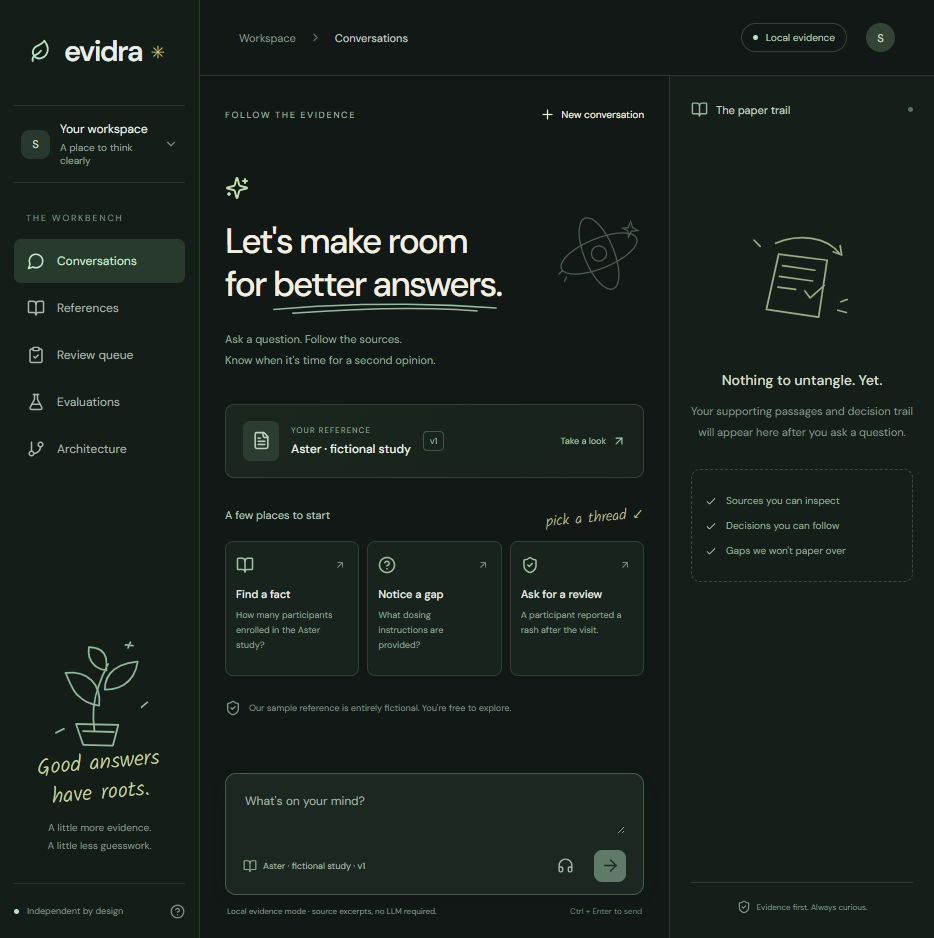

# Evidra

An answer should come with something you can check.

Evidra is an independent workspace for document-backed conversations, review queues, and repeatable evaluations. It is built to make the awkward cases visible: missing evidence, invented citations, ambiguous questions, and changes between document versions.

The interface pairs charcoal surfaces and mint accents with a few hand-drawn SVG illustrations. The product has its own identity and implementation. Public engineering writing from Synthio Labs helped frame the problem; Evidra is not affiliated with Synthio.



## Development

```powershell
python -m venv .venv
.venv\Scripts\python -m pip install -r requirements.lock.txt
.venv\Scripts\python -m pip install -e . --no-deps
.venv\Scripts\python -m uvicorn evidra.api:app --app-dir backend --host 127.0.0.1 --port 8000
```

In a second terminal:

```powershell
cd frontend
npm ci
npm run dev
```

Open the printed frontend URL. Vite proxies `/api` to the local backend. Start with the included fictional reference or import your own text/Markdown/PDF. Documents and review history persist in `data/evidra.db`.

## Model modes

- **Local evidence mode** runs without model downloads or API keys. It returns verbatim retrieved excerpts. It is not an LLM and is labeled that way in the interface.
- **Ollama mode** uses a locally running model, configured with `EVIDRA_PROVIDER=ollama`, `EVIDRA_OLLAMA_URL`, and `EVIDRA_MODEL`. Evidence references and output schema are validated before display. The default model is `qwen3:8b`.

This is an engineering demo, not a medical product or a compliance certification. All bundled conversations and research facts are fictional. A citation existing does not prove that a model's interpretation is correct.

## Checks

```powershell
.venv\Scripts\python -m pytest
cd frontend
npm run build
```

See [system design](docs/system-design.md), [decisions](docs/decisions.md), and [evaluation notes](docs/evaluations.md) for behavior, tradeoffs and limits.

The pinned setup was tested with Python 3.12. See [development notes](docs/development.md), [open-source components](docs/open-source.md), and [verification results](docs/verification.md) for optional model setup and the tested scope.
