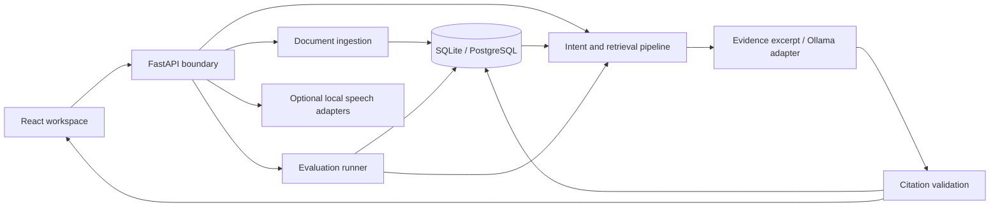

# System design

## Scope

One developer workspace, multiple versioned documents, persistent conversations, review decisions, and saved evaluation runs. A modular Python service owns the data and pipeline; a React client owns presentation. This is a local-first application. The initial deployment has no account system and must stay on loopback.

## Boundaries

- `api.py`: request validation, file limits, HTTP error mapping. No generation policy in route handlers.
- `db.py`: SQLAlchemy models and session lifecycle. SQLite for setup; PostgreSQL through `EVIDRA_DATABASE_URL`.
- `documents.py`: extraction, hashing, versioning and source locations.
- `pipeline.py`: intent routing, evidence selection, provider interaction and decision trace.
- `evaluations.py`: versioned cases and baseline comparison.
- `voice.py`: optional speech libraries, loaded only when requested.

## Data flow

Document bytes are size-limited and parsed. Every import receives a content hash and per-title version. PDF page locations are retained; text imports have section locators. Passage records belong to a specific immutable document. A question selects one document ID rather than an unversioned title.

Local evidence mode ranks passages with exact-token overlap and returns excerpts. This provides an honest offline baseline, not semantic retrieval. Optional embedding retrieval is a future extension. Ollama mode uses the same selected evidence and requests structured JSON. Nonexistent citations and empty evidence are rejected. No generated answer is represented as clinically verified.

Every conversation turn records the actual document/version, evidence IDs, provider/model, answer, disposition, reasons and elapsed times. The user sees a decision trace, not a model's private reasoning. Human review decisions attach to the original turn and do not rewrite it.

## Failure behavior

No evidence produces an abstention. Safety mentions in fictional scenarios enter a review queue. Invalid structured output or unknown citations enter review. A provider timeout produces an explicit review result; the service does not silently switch models. Unsupported files and empty extraction return a useful client error.

## Trust boundary

Model endpoints are configured by the server environment, never arbitrary browser requests. Uploaded text is untrusted data. Prompts describe that boundary, but prompt wording alone is not a defense: retrieval is document-scoped and output references are checked against supplied passages. The browser is same-origin through the dev proxy; public deployment requires authentication, tenant isolation, upload scanning, rate limits and a migration process before accepting real data.

## Scaling path

Keep this as a modular monolith until work volume justifies separation. Move SQLite to PostgreSQL; introduce an ingestion/evaluation worker and bounded job queue for large files and runs. Add token-aware semantic retrieval with pgvector only after lexical failure cases are measured. Use document-scoped cache keys including hash, model and policy version. Voice verification adds latency, so measure the full path before attempting sentence streaming.

## Known limits

Rule-based intent classification can miss unusual safety language. Token matching misses paraphrases. Citation membership checks establish provenance, not semantic support. SQLite is a single-workspace choice; the app does not claim production tenancy or medical validation. Evaluation outcomes measure fixture expectations, not clinical accuracy.

## Guided voice experience

The primary visitor flow is choose a document → talk → check the source. `Guided.tsx` owns that journey; the existing version, review, evaluation and architecture tools are lazy-loaded in `Workbench.tsx`. Both use the same API session module, so moving between views retains visitor isolation without creating another identity.

The Northstar sample is created idempotently per visitor through `/api/demo`. The Aster evaluation fixture stays separate. Voice state controls prevent changing documents or language during a microphone turn. An aborted voice request cancels its queued subscription; a request already executing may still finish on the server. The app checks its conversation generation before displaying a response.

Hindi transcription uses multilingual Whisper. The question is translated into English in the GPU handler before existing retrieval and policy checks. The original transcript, translated search text, language and citations are retained. Qwen generates a cited English answer. Marian opus-mt-en-hi translates it into Hindi, with a number-preservation check. Marian opus-mt-hi-en translates incoming questions on CPU. Translation quality is not guaranteed for malformed transcripts. Failed translation returns an error rather than a fabricated answer. Stored language selects the matching Piper voice for replay.

The shared model queue has 16 waiting jobs and one inference slot. CPU voice work has two slots and a 30-second bounded wait. This is suitable for testing ten independent sessions with queues; it is not a guarantee of ten simultaneous low-latency calls on free hardware. Heavy evaluations share the same queue and can delay questions.
